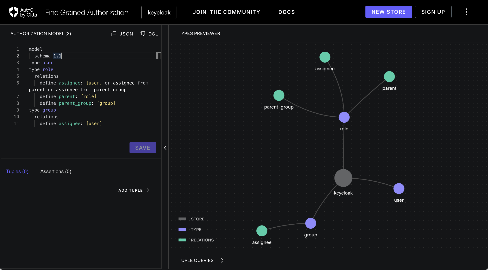
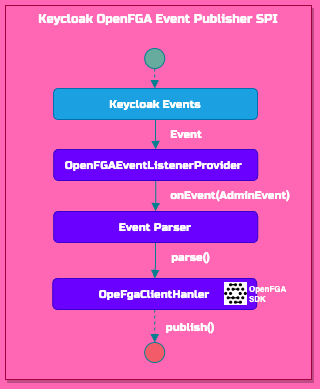
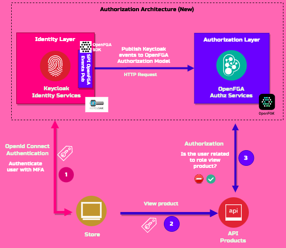

# Keycloak OpenFGA Event Publisher

This is a Keycloak extension that implements an Event Listener Provider to detect identity events and publish them to the OpenFGA server over HTTP, using the [OpenFGA Java SDK](https://github.com/openfga/java-sdk).
It provides a direct integration between [Keycloak](https://www.keycloak.org/) and [OpenFGA](https://openfga.dev/). OpenFGA is an open source solution for Fine-Grained Authorization that applies the concept of ReBAC (Relationship-Based Access Control), created by Auth0 and inspired by Google Zanzibar.

The extension follows these steps:

1. Listens to the Keycloak events of its identity, role and group model (e.g., User Role Assignment, Role to Role Assignment, etc.).

2. Converts these events into OpenFGA tuple keys based on the [Keycloak authorization model](model.dsl) ([JSON](model.json)):
<p align="center">
  
</p>

3. Publishes the tuple keys to OpenFGA using the [OpenFGA Java SDK](https://github.com/openfga/java-sdk). Apps and APIs can then use OpenFGA as a PDP (Policy Decision Point) to enforce the authorization policies.

## Quick Start

Requires Java 17+, Maven and Docker. The demo uses the host ports `8080`, `8081`, `3000`, `5432`, `5433`, `9080` and `8443`.

**1. Build the extension and start Keycloak and OpenFGA**

```shell
mvn clean package
docker compose up -d
```

[docker-compose.yml](docker-compose.yml) starts Keycloak with the extension on http://localhost:9080 (`admin` / `password`) and OpenFGA on http://localhost:8080. The `openfga-import` service creates the `keycloak` store with the [authorization model](model.dsl) ([openfga-store.yaml](openfga-store.yaml)).

**2. Enable the extension and make some changes**

In the [Admin Console](http://localhost:9080/admin), go to Realm settings > Events and add `openfga-events-publisher` to the Event Listeners. Then create the roles `admin-catalog` and `view-product`, make `view-product` an associated role of `admin-catalog`, create the user `paula` and assign her `admin-catalog`.

<details>
<summary>Or with <code>kcadm.sh</code></summary>

```shell
kcadm() { docker exec keycloak /opt/keycloak/bin/kcadm.sh "$@"; }
kcadm config credentials --server http://localhost:8080 --realm master --user admin --password password
kcadm update events/config -r master -s 'eventsListeners=["openfga-events-publisher","jboss-logging"]'
kcadm create roles -r master -s name=admin-catalog
kcadm create roles -r master -s name=view-product
kcadm add-roles -r master --rname admin-catalog --rolename view-product
kcadm create users -r master -s username=paula -s enabled=true
kcadm add-roles -r master --uusername paula --rolename admin-catalog
```

</details>

**3. See the tuples in OpenFGA**

```shell
STORE_ID=$(curl -s http://localhost:8080/stores | sed -n 's/.*"id":"\([^"]*\)".*/\1/p')
curl -s -X POST http://localhost:8080/stores/$STORE_ID/read -H "Content-Type: application/json" -d '{}'
```

The store now holds `role:admin-catalog parent role:view-product` and `user:<paula's user id> assignee role:admin-catalog`. See the [example](#example) to check her permissions.

**4. Stop the demo**

```shell
docker compose down -v
```

## How does it work?
The extension listens to the Keycloak Admin Events related to the identity, role and group model:

<p align="center">
  
</p>

1. Parses and enriches the Keycloak admin events in the table below.
2. Transforms each event into an OpenFGA `ClientWriteRequest` with the OpenFGA Java SDK: a tuple write when the assignment is created, a tuple delete when it is removed.
3. Publishes the `ClientWriteRequest` to the OpenFGA server over HTTP (`fgaClient.write(request)`) with the [OpenFGA SDK client](https://github.com/openfga/java-sdk).

| Keycloak Event | Description | OpenFGA Tuple Key |
|----------------|-------------|-------------------|
| User Role Assignment | A user is assigned a realm role | `user:<userId>` `assignee` `role:<roleName>` |
| Role to Role Assignment | A role is added to a composite (parent) role | `role:<parentRole>` `parent` `role:<childRole>` |
| Group to Role Assignment | A group is assigned a realm role (see [Known limitations](#known-limitations)) | `group:<group>` `parent_group` `role:<roleName>` |
| User Group Membership | A user joins a group | `user:<userId>` `assignee` `group:<groupName>` |
| Service Account Role Assignment | A client's service account is assigned a realm or client role | `client:<clientId>` `assignee` `role:<roleName>` |

These are the events handled by the provided [authorization model](model.dsl). You can edit the model to handle the events you need: an event is published only if the model has the matching relation.

Only **admin events** are handled: changes made through the Admin Console, the Admin REST API or `kcadm.sh`. Changes made any other way publish nothing, for example the default roles given at user self-registration, mappers of identity providers or LDAP, and realm imports at startup.

<details>
<summary><b>Example</b>: from a role assignment to a permission check</summary>

#### Example

An administrator makes `admin-catalog` a composite role that contains `view-product`, then assigns `admin-catalog` to the user `paula`. The extension publishes:

```
role:admin-catalog       parent    role:view-product
user:<paula's user id>   assignee  role:admin-catalog
```

An app can then ask OpenFGA whether `paula` has `view-product`, which she inherits through `admin-catalog`:

```shell
curl -X POST http://localhost:8080/stores/<store id>/check \
  -H "Content-Type: application/json" \
  -d '{"tuple_key": {"user": "user:<paula'\''s user id>", "relation": "assignee", "object": "role:view-product"}}'
# {"allowed": true, ...}
```

</details>

<details>
<summary><b>Identifiers</b>: users by id, roles, groups and clients by name</summary>

* Users are published by **id** (`user:<userId>`), the same value as the `sub` claim of their tokens, so apps can check with the subject of the token they receive.
* Roles, groups and clients are published by **name** (`role:<roleName>`, `group:<groupName>`, `client:<clientId>`). Renaming one in Keycloak does not update the tuples already in OpenFGA.

</details>

<details>
<summary><b>Solution Architecture Overview</b></summary>

This extension improves the authorization architecture described in the article [Keycloak integration with OpenFGA (based on Zanzibar) for Fine-Grained Authorization at Scale (ReBAC)](https://embesozzi.medium.com/keycloak-integration-with-openfga-based-on-zanzibar-for-fine-grained-authorization-at-scale-d3376de00f9a)
by enabling direct event synchronization between the Access Manager Platform and the OpenFGA Server.

<p align="center">
  
</p>

* Core:
    * Keycloak handles authentication with standard OpenID Connect and manages user access with its role model.
    * Keycloak runs this extension, which listens to the Keycloak events, parses each event into an OpenFGA tuple based on the [Keycloak authorization model](model.dsl) and publishes it to OpenFGA over HTTP.
    * OpenFGA applies fine-grained access control. It answers authorization checks by determining whether a relationship exists between an object and a user.
* Other components (in the [workshop](https://github.com/embesozzi/keycloak-openfga-workshop)):
    * The Store Web Application is integrated with Keycloak by OpenID Connect.
    * The Store API is protected by OAuth 2.0 and uses the OpenFGA SDK for fine-grained authorization.

</details>

## Compatibility

Tested with Keycloak `25.0.1` (Quarkus-based distribution) and OpenFGA `v1.5.5`.

## How to install?

Download a release (`*.jar` file) that works with your Keycloak version from the [list of releases](https://github.com/embesozzi/keycloak-openfga-event-publisher/releases), or build it:

```shell
mvn clean package
```

The jar is created at `target/keycloak-openfga-event-publisher.jar`.

<details>
<summary>Keycloak distribution</summary>

Copy the jar to the `providers` folder and run:

```shell
${kc.home.dir}/bin/kc.sh build
```

</details>

<details>
<summary>Container image (Docker)</summary>

Mount or copy the jar to `/opt/keycloak/providers`. See [docker-compose.yml](docker-compose.yml).

</details>

## Module Configuration
The following properties can be set via environment variables following the Keycloak conventions. Each variable uses the prefix `KC_SPI_EVENTS_LISTENER_OPENFGA_EVENTS_PUBLISHER_`.

* `KC_SPI_EVENTS_LISTENER_OPENFGA_EVENTS_PUBLISHER_OPENFGA_API_URL`: the URL of the OpenFGA server. If not set, the extension uses `http://openfga:8080`, for demo purposes only.

* Optional `KC_SPI_EVENTS_LISTENER_OPENFGA_EVENTS_PUBLISHER_OPENFGA_STORE_ID` and `KC_SPI_EVENTS_LISTENER_OPENFGA_EVENTS_PUBLISHER_OPENFGA_AUTHORIZATION_MODEL_ID`: the store and authorization model identifiers in the OpenFGA server. If not set, the extension discovers them on the first event: it uses the first store and that store's latest authorization model.

## Keycloak Configuration

### Enable the OpenFGA Event Publisher extension in Keycloak
Enable the extension in each realm:

* Open the administration console
* Choose the realm
* Go to Realm settings
* Select the `Events` tab and add `openfga-events-publisher` to Event Listeners

<details>
<summary>Screenshot</summary>


</details>

## Known limitations

* **Group to Role Assignment**: role mappings on a group publish the group id (`group:<groupId>`), while memberships publish the group name (`group:<groupName>`), so group members do not inherit the group's roles ([issue #4](https://github.com/embesozzi/keycloak-openfga-event-publisher/issues/4)).
* **Explicit store and model ids**: when `..._OPENFGA_STORE_ID` and `..._OPENFGA_AUTHORIZATION_MODEL_ID` are set, discovery is skipped and the authorization model is not loaded, so events fail. Leave them unset to use discovery.
* **Client roles** share the `role:<roleName>` namespace with realm roles, so a client role and a realm role with the same name map to the same OpenFGA object.
* **OpenFGA unavailable**: each event is written to OpenFGA during the admin request, with a 5 second timeout. If OpenFGA is down or the write fails, Keycloak logs the error (`KC-SERVICES0085`) and the change is not published: there is no retry or resynchronization.
* **Admin events only**: changes that do not produce Keycloak admin events are not published (see [How does it work?](#how-does-it-work)).

## Testing

Requires Java 17+ and Maven. The integration tests also need Docker.

```shell
mvn test      # unit tests: Keycloak event in, OpenFGA tuple out
mvn verify    # unit tests + integration tests
```

<details>
<summary>About the integration tests</summary>

The integration tests (`*IntegrationTest`) start Keycloak with the packaged extension and OpenFGA with [model.json](model.json) using [Testcontainers](https://testcontainers.com/), make changes through the Keycloak admin API, and check the resulting tuples and permissions in OpenFGA. They are skipped when Docker is not available. To test other versions:

```shell
mvn verify -Dkeycloak.image=quay.io/keycloak/keycloak:25.0.1 -Dopenfga.image=openfga/openfga:v1.5.5
```

</details>

## Demo and Articles

* Workshop with the full demo environment: [keycloak-openfga-workshop](https://github.com/embesozzi/keycloak-openfga-workshop)
* Articles:
    * [Mastering Access Control: Low-Code Authorization with ReBAC, Decoupling Patterns and Policy as Code](https://embesozzi.medium.com/mastering-access-control-implementing-low-code-authorization-based-on-rebac-and-decoupling-pattern-f6f54f70115e)
    * [Keycloak integration with OpenFGA based on Zanzibar for Fine-Grained Authorization at Scale (ReBAC)](https://medium.com/@embesozzi/keycloak-integration-with-openfga-based-on-zanzibar-for-fine-grained-authorization-at-scale-d3376de00f9a)
