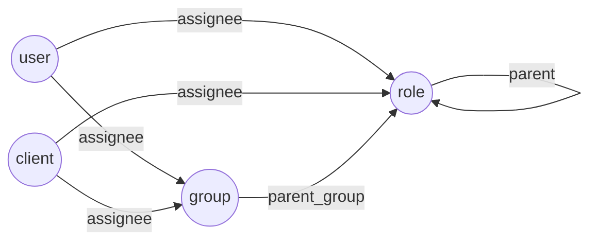
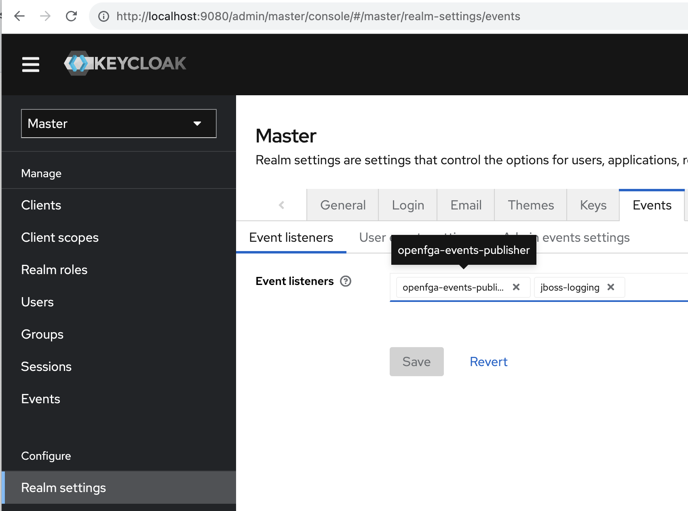

# Keycloak OpenFGA Event Publisher

A Keycloak extension that keeps [OpenFGA](https://openfga.dev/) in sync with [Keycloak](https://www.keycloak.org/): when an administrator assigns a role, adds a role to a composite or adds a user to a group, the extension publishes the matching relationship tuple to OpenFGA. Apps and APIs then use OpenFGA to check permissions.

Tuples follow this authorization model ([model.dsl](model.dsl), [JSON](model.json)):

```
model
  schema 1.1
type user
type client
type group
  relations
    define assignee: [user, client]
type role
  relations
    define assignee: [user, client] or assignee from parent or assignee from parent_group
    define parent: [role]
    define parent_group: [group]
```

The same model as a graph. Each arrow is a tuple, read as `user --relation--> object`:



OpenFGA resolves the inheritance: the assignees of a role include the assignees of its parent roles and the members of the groups that have the role.

## Quick Start

Requires Java 17+, Maven and Docker. The demo uses the host ports `8080`, `8081`, `3000`, `5432`, `5433`, `9080` and `8443`.

**1. Build the extension and start Keycloak and OpenFGA**

```shell
mvn clean package
docker compose up -d
```

Keycloak runs on http://localhost:9080 (`admin` / `password`) and OpenFGA on http://localhost:8080, with a store named `keycloak` and the authorization model.

**2. Enable the extension and make some changes**

In the [Admin Console](http://localhost:9080/admin), go to Realm settings > Events and add `openfga-events-publisher` to the Event Listeners. Then create the roles `admin-catalog` and `view-product`, make `view-product` an associated role of `admin-catalog`, create the user `paula` and assign her `admin-catalog`.

<details>
<summary>Or with <code>kcadm.sh</code></summary>

```shell
kcadm() { docker exec keycloak /opt/keycloak/bin/kcadm.sh "$@"; }
kcadm config credentials --server http://localhost:8080 --realm master --user admin --password password
kcadm update events/config -r master -s 'eventsListeners=["openfga-events-publisher","jboss-logging"]'
kcadm create roles -r master -s name=admin-catalog
kcadm create roles -r master -s name=view-product
kcadm add-roles -r master --rname admin-catalog --rolename view-product
kcadm create users -r master -s username=paula -s enabled=true
kcadm add-roles -r master --uusername paula --rolename admin-catalog
```

</details>

**3. Check in OpenFGA**

```shell
STORE_ID=$(curl -s http://localhost:8080/stores | sed -n 's/.*"id":"\([^"]*\)".*/\1/p')
PAULA_ID=...   # paula's user id, from the Admin Console (Users > paula)

curl -s -X POST http://localhost:8080/stores/$STORE_ID/check -H "Content-Type: application/json" \
  -d "{\"tuple_key\": {\"user\": \"user:$PAULA_ID\", \"relation\": \"assignee\", \"object\": \"role:view-product\"}}"
# {"allowed":true, ...}  paula has view-product through admin-catalog
```

**4. Stop the demo**

```shell
docker compose down -v
```

## How does it work?

The extension listens to Keycloak admin events and publishes one tuple per change: a write when something is assigned, a delete when it is removed.

| Keycloak change | OpenFGA tuple |
|-----------------|---------------|
| A user is assigned a role | `user:<userId>` `assignee` `role:<role>` |
| A role is added to a composite role | `role:<parentRole>` `parent` `role:<childRole>` |
| A group is assigned a role | `group:<group>` `parent_group` `role:<role>` |
| A user joins a group | `user:<userId>` `assignee` `group:<group>` |
| A client's service account is assigned a role | `client:<clientId>` `assignee` `role:<role>` |
| A client's service account joins a group | `client:<clientId>` `assignee` `group:<group>` |

Roles, groups and clients are identified by name by default; see [Identifiers in OpenFGA](#identifiers-in-openfga).

Only admin events are published: changes made in the Admin Console, the Admin REST API or `kcadm.sh`.

## How to install?

Download the jar from the [releases](https://github.com/embesozzi/keycloak-openfga-event-publisher/releases), or build it with `mvn clean package` (`target/keycloak-openfga-event-publisher.jar`).

* **Keycloak distribution:** copy the jar to the `providers` folder and run `bin/kc.sh build`.
* **Container image:** mount or copy the jar to `/opt/keycloak/providers` (see [docker-compose.yml](docker-compose.yml)).

### Compatibility

| Extension | Keycloak | OpenFGA (tested) |
|-----------|----------|------------------|
| 3.0.x | 26.x (tested 26.0.8 and 26.8.2) | v1.23.0 |
| 2.0.x | 25.x | v1.5.5 |
| 1.1.x, 1.2.x | 25.x | v1.5.5 |
| 1.0.x | 19.x | v1.3.1 |

## Configuration

Set with environment variables:

| Variable | Description | Default |
|----------|-------------|---------|
| `KC_SPI_EVENTS_LISTENER_OPENFGA_EVENTS_PUBLISHER_OPENFGA_API_URL` | OpenFGA server URL | `http://openfga:8080` (demo only) |
| `KC_SPI_EVENTS_LISTENER_OPENFGA_EVENTS_PUBLISHER_OPENFGA_STORE_NAME` | Name of the store to publish to | `keycloak` |
| `KC_SPI_EVENTS_LISTENER_OPENFGA_EVENTS_PUBLISHER_OPENFGA_STORE_ID` | Store id, instead of the name | |
| `KC_SPI_EVENTS_LISTENER_OPENFGA_EVENTS_PUBLISHER_OPENFGA_AUTHORIZATION_MODEL_ID` | Authorization model id | latest model of the store |
| `KC_SPI_EVENTS_LISTENER_OPENFGA_EVENTS_PUBLISHER_OPENFGA_IDENTIFIER` | How roles, groups and clients are identified: `name` or `id` | `name` |
| `KC_SPI_EVENTS_LISTENER_OPENFGA_EVENTS_PUBLISHER_OPENFGA_CREDENTIALS_METHOD` | How to authenticate to OpenFGA: `none`, `api_token` or `client_credentials` (see below) | `none` |

### Authentication

Use the method that matches your OpenFGA server's [authentication](https://openfga.dev/docs/getting-started/setup-openfga/configure-openfga#configuring-authentication). Each variable starts with `KC_SPI_EVENTS_LISTENER_OPENFGA_EVENTS_PUBLISHER_`:

| Method | Variables |
|--------|-----------|
| `api_token` (pre-shared key) | `OPENFGA_API_TOKEN` |
| `client_credentials` (OIDC) | `OPENFGA_CLIENT_ID`, `OPENFGA_CLIENT_SECRET`, `OPENFGA_API_TOKEN_ISSUER`, and optionally `OPENFGA_API_AUDIENCE` and `OPENFGA_SCOPES` |

`OPENFGA_API_TOKEN_ISSUER` is the token endpoint URL, for example `https://keycloak.example.com/realms/my-realm/protocol/openid-connect/token`. With only a host name, `/oauth/token` is added.

<details>
<summary>Example: OpenFGA protected by Keycloak (OIDC)</summary>

1. In Keycloak, create a confidential client with service accounts enabled (for example `openfga-publisher`), and add an Audience mapper with the audience OpenFGA expects (for example `openfga`).
2. Start OpenFGA with `OPENFGA_AUTHN_METHOD=oidc`, `OPENFGA_AUTHN_OIDC_ISSUER=https://keycloak.example.com/realms/my-realm` and `OPENFGA_AUTHN_OIDC_AUDIENCE=openfga`.
3. Configure the extension:

```shell
KC_SPI_EVENTS_LISTENER_OPENFGA_EVENTS_PUBLISHER_OPENFGA_CREDENTIALS_METHOD=client_credentials
KC_SPI_EVENTS_LISTENER_OPENFGA_EVENTS_PUBLISHER_OPENFGA_CLIENT_ID=openfga-publisher
KC_SPI_EVENTS_LISTENER_OPENFGA_EVENTS_PUBLISHER_OPENFGA_CLIENT_SECRET=<client secret>
KC_SPI_EVENTS_LISTENER_OPENFGA_EVENTS_PUBLISHER_OPENFGA_API_TOKEN_ISSUER=https://keycloak.example.com/realms/my-realm/protocol/openid-connect/token
KC_SPI_EVENTS_LISTENER_OPENFGA_EVENTS_PUBLISHER_OPENFGA_API_AUDIENCE=openfga
```

The issuer must match exactly: the `iss` of the tokens Keycloak issues is the URL OpenFGA is configured with.

</details>

Then enable the extension in each realm: Realm settings > Events > add `openfga-events-publisher` to the Event Listeners.

<details>
<summary>Screenshot</summary>



</details>

## Identifiers in OpenFGA

Apps and PEPs (gateways, API middleware) must call OpenFGA with the same ids the extension publishes, or checks return `false`.

| | `name` (default) | `id` |
|--|------------------|------|
| User | `user:<userId>` (the token's `sub`) | `user:<userId>` |
| Realm role | `role:<roleName>` | `role:<roleId>` |
| Client role | `role:<clientId>/<roleName>` | `role:<roleId>` |
| Group | `group:<groupName>` | `group:<groupId>` |
| Service account | `client:<clientId>` (the token's `azp`) | `client:<client internal id>` |

* **`name`**: ids can be built from tokens and configuration. Names are percent-encoded, see below.
* **`id`**: ids survive renames, but a PEP needs the Keycloak ids of the roles, groups and clients it checks.

For a service-account token (client credentials), check `client:<azp>`, not `user:<sub>`: `sub` is the service account's internal user id, which is not published.

To check a role, check the role you need: OpenFGA resolves composite roles and groups. Don't check every role of the token; some, such as `default-roles-<realm>`, are never published.

### Encoding names

OpenFGA does not accept `:`, `#` or spaces in ids. With `name`, each role, group and client name is percent-encoded ([RFC 3986](https://www.rfc-editor.org/rfc/rfc3986), UTF-8, uppercase hex) for these characters only: `%`, `/`, `:`, `#`, and control and space characters (Unicode `Cc`, `Zs`, `Zl`, `Zp`). Every other character is kept.

| Keycloak name | OpenFGA id |
|---------------|------------|
| realm role `view-product` | `role:view-product` |
| realm role `Account Manager` | `role:Account%20Manager` |
| client role `read` of client `store-api` | `role:store-api/read` |
| client `spiffe://example.org/agent` | `client:spiffe%3A%2F%2Fexample.org%2Fagent` |

Generic URL encoders such as `encodeURIComponent` encode more characters. Use one of these instead:

<details>
<summary>JavaScript, Python, Go, Java</summary>

```javascript
const ENCODE = /[%/:#\p{Cc}\p{Zs}\p{Zl}\p{Zp}]/u;
const encode = (name) => Array.from(name)
  .map((c) => ENCODE.test(c) ? encodeURIComponent(c) : c)
  .join("");
```

```python
import unicodedata

def encode(name: str) -> str:
    return "".join(
        "".join(f"%{b:02X}" for b in c.encode("utf-8"))
        if c in "%/:#" or unicodedata.category(c) in ("Cc", "Zs", "Zl", "Zp") else c
        for c in name)
```

```go
func encode(name string) string {
	var b strings.Builder
	for _, r := range name {
		if strings.ContainsRune("%/:#", r) || unicode.In(r, unicode.Cc, unicode.Zs, unicode.Zl, unicode.Zp) {
			for _, c := range []byte(string(r)) {
				fmt.Fprintf(&b, "%%%02X", c)
			}
		} else {
			b.WriteRune(r)
		}
	}
	return b.String()
}
```

Java: [`OpenFgaIds.encode`](src/main/java/com/twogenidentity/keycloak/utils/OpenFgaIds.java).

</details>

## Known limitations

* **OpenFGA unavailable:** if a write fails, Keycloak logs it (`KC-SERVICES0085`) and the change is not published. There is no retry.
* **Deletes and renames:** deleting or renaming a user, role, group or client does not update its tuples in OpenFGA.
* **Admin events only:** default roles at registration, identity provider and LDAP mappers, and realm imports are not published.

## Upgrading from 2.0

* **Keycloak 26** is required. For Keycloak 25, stay on 2.0.x.

## Upgrading from 1.2

* **Client roles** are now `role:<clientId>/<roleName>` (were `role:<roleName>`).
* **Names with `/`, `:`, `#` or spaces** are now percent-encoded.
* **Group role assignments** now use the group name, like memberships (were the group id).
* **Model:** `group#assignee` now accepts `client`, so service accounts can join groups. Write the new [model.dsl](model.dsl) to your store.
* **Store:** the extension now uses the store named `keycloak` (was the first store). Set `..._OPENFGA_STORE_NAME` or `..._OPENFGA_STORE_ID` if yours has another name.

## Testing

```shell
mvn test      # unit tests
mvn verify    # unit and integration tests (needs Docker)
```

The integration tests run Keycloak and OpenFGA with [Testcontainers](https://testcontainers.com/). Other versions: `mvn verify -Dkeycloak.image=... -Dopenfga.image=...`.

## Demo and Articles

* Full demo environment: [keycloak-openfga-workshop](https://github.com/embesozzi/keycloak-openfga-workshop)
* [Keycloak integration with OpenFGA based on Zanzibar for Fine-Grained Authorization at Scale (ReBAC)](https://medium.com/@embesozzi/keycloak-integration-with-openfga-based-on-zanzibar-for-fine-grained-authorization-at-scale-d3376de00f9a)
* [Mastering Access Control: Low-Code Authorization with ReBAC, Decoupling Patterns and Policy as Code](https://embesozzi.medium.com/mastering-access-control-implementing-low-code-authorization-based-on-rebac-and-decoupling-pattern-f6f54f70115e)
